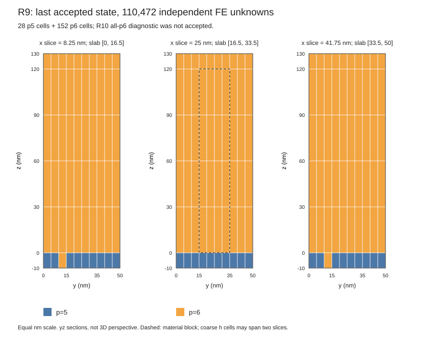
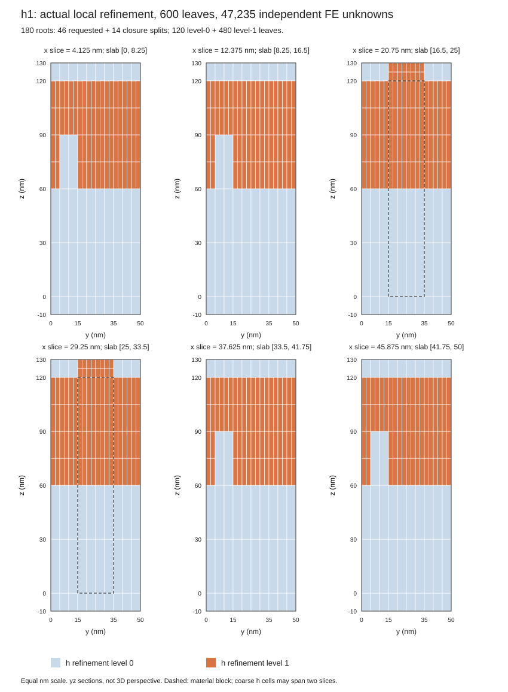
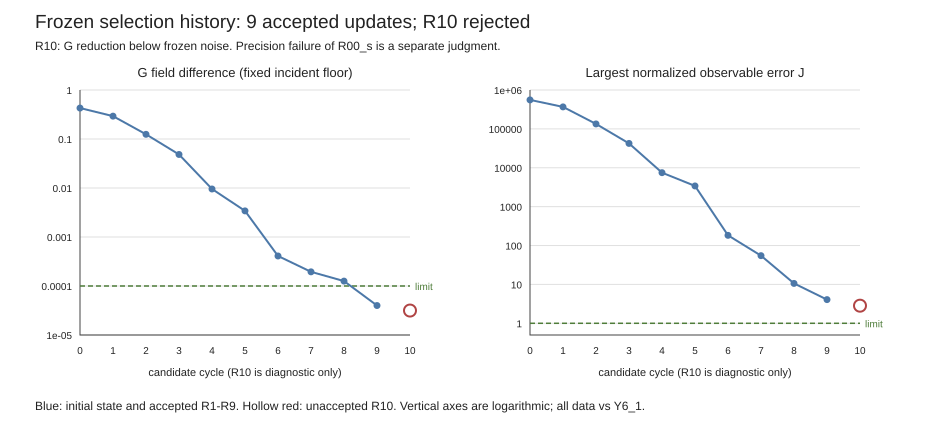

# Task43 结果：部分完成，受控负结果

## V15 当前状态：P5诊断完成但不获接受；A1/P4 FAILED 保留

本轮把少量大网格单元切成小单元（局部 h 加密），只测试预先固定的 seed8，并保留相邻面需要的闭包。FE 是约束后独立未知量数；J 把各输出与固定 Y6_1 场的差除以各自容差，取其中最大值，因此 J>1 表示至少一项尚超容差。G（文中 η）衡量全域电场及其旋度的加权相对差，越小越接近这个离散参考，不代表已知连续真误差。ΔJ、ΔG均为R9减h；每新增FE收益再除以6,268。primary 指正常修正之后、额外诊断修正之前的固定场，本轮normal一次、extra零。A_volume表示体内吸收占入射功率的比例。

V15 修复普通研究入口接线缺陷。P2_BUGFIX 固定绑定真实授权、旧失败原件与 joined 产品，实际闭包为194叶、FE 116,740（较R9 +6,268），空间审计 root-verified。P3原A1正式运行因只读视图将范围转为tuple、而保存JSON为list导致raw-scope表示错误而失败；保存 primary 的独立 raw 重算过阈值，并在独立、非official的 saved-primary continuation 中完成 q8/q10 与 Av/能量闭合门，但旧 A1 FAILED terminal 不改写。P4 R9_H8 实际求解的 raw 数值门通过，末尾 JSON summary 序列化 ndarray 失败，P4仍FAILED。新 P5 opt-in adapter 使用原FAILED P4 primary完成q8/q10公共积分诊断；状态为COMPLETE_DIAGNOSTIC_NOT_ACCEPTANCE，不改变P4 endpoint资格。

| 对象 | 当前状态/实测 | 科学与文件身份边界 |
|---|---|---|
| P2_BUGFIX | 180根→194叶；p5/p6=35/159；FE=116,740；trace/interior=36,790/79,950；较R9增加6,268；whole=959.6084092017263 s | measured空间审计；不是PDE装配或新解；joined terminal见 records/v15_bugfix_sources/P2/ |
| A1_q_attempt3 | FAILED_RESEARCH_SCOPE_CONTAINER_MISMATCH；formal whole=3036.0769646498375 s；raw A6=8.162860542115928e-9≤1e-8 | 原正式终态与primary字节不变；原入口q8/q10/Av未完成 |
| A1 saved-primary continuation | 44.807101065758616 s；RSS采样树峰739,282,944 B、task swap 0；A_volume=.6915150591709378；闭合4.103828388224429e-12≤1e-5 | root joined；非official旧场后处理，不冒充正式A1通过 |
| R9_H8_attempt1 | R/T/Av=.2513585633216903 / .057125759200644305 / .691515677476035；rows37402，NNZused/allocated=30072292/36616200；raw A6=7.77267194814766e-9≤1e-8；full Gram=5.203523992032973e-13≤1e-8；condensed=5.323075566556481e-13≤1e-9；R/T/Av保存 | whole=2174.3347835741006 s；因summary ndarray JSON编码失败最终FAILED；terminal不改写 |
| P5 saved-primary union | COMPLETE_DIAGNOSTIC_NOT_ACCEPTANCE；q8/q10均NO_CLEAR_OUTPUT_GAIN_AT_FROZEN_SCALE | 原P4 terminal仍FAILED；official_result=false、passed=false、无selection transition |
| P5结果与阈值 | J_R9=4.065061945224269，J_h=3.9745473239816143，ΔJ=0.09051462124265441<εJ=0.12716416232413652；q8/q10 η分别为3.995683423458671e-5→4.547357272406127e-5、3.9956834234581814e-5→4.5473572724057846e-5 | 两档η增幅约5.51673849e-6<εG=9.088158796603444e-6；ΔJ不足以触发positive条件 |
| 每新增FE收益 | ΔJ/6268=1.4440750038713213e-5；q10 ΔG/6268=−8.801433454811793e-10 | G未改善，J改善未越过冻结噪声尺度；不接受新状态 |
| P5精度/资源 | h的R00_s差=3.9745473239816143e-6>1e-6，J_h>1；whole=1,134.8697960400023 s，RSS采样峰=1,621,196,800 B，swap=0，退出0/0/0 | accuracy仍NOT_PASSED；RSS为采样同时进程树峰，后代已清理 |
| P5采样/参考 | 公共域350,000 nm³、612模态；q8=565,248点、q10=1,104,000点；R9/H FE=110,472/116,740（+6,268） | Y6_1参考为576格/FE=380,160；6×10×6控制FE=237,600，口径分开 |
| formal账户 | V15新增2次，累计7/8；sealed历史槽仍封存 | P5不增加PDE dispatch；不得据P5诊断改变accepted9 |
| 能力裁决 | space/selection PARTIAL；accuracy NOT_PASSED；equal-accuracy total cost NOT_ESTABLISHED；iteration NOT_RUN/NOT_QUALIFIED | accepted9/R9仍为末态，R10仍拒绝；无生产/merge资格 |

定向测试记录：A1 scope首次验证17.657307378947735 s，2 passed/1 failed/12 not run；修正phase fixture后新root 14/14通过，22.31426020199433 s。P2 resolver/joined-binding focused 10/10 passed，29.47382813040167 s。P4/P5 saved-primary验证首轮13节点10 passed/1 failed/2 not run，whole 22.533459630794823 s、RSS采样峰276,164,608 B；失败原因是前置快照漏binding自身而后置快照包含。主控承认预审漏掉该不对称；worker已退出、root读取完成前的source复核仅compare与初始不同，其他源项和所有输入未变，非运行中漂移。修复后4个新节点（真实main、opt-in两参数、joined拒绝）4/4 passed，pytest 6.59 s、whole 9.225778500083834 s、RSS采样峰260,907,008 B、退出0/0/0；其余9个同字节/未改函数按历史成功结果复用，共13 unique。Root gate见v15_bugfix_sources/h_validation_recovered/h_saved_primary_validation_root_gate.json。

V15已结束的8次support whole累计2,240.4899401497096 s；2次formal whole小计5,210.411748223938 s。历史V12/V14 recovery 2,215.2188096446916 s及V11 support 853.8004706790671 s另列，不并入本轮单次成本。P5 comparison/watchdog原件位于 `benchmarks/artifacts/task43/v11_science/support/union_comparison_attempt1/`；root joined closeout SHA256为 `5f2312d3bdf52a410a777e8e119ec8dbf6af992adb8bd575e12e0579e381165d`。

详见[Response V15](../response_v15.md)与[V15机器结果](records/v15_bugfix_and_scientific_results_v1.json)。

V15 review 补充确认两条超限功率通道（候选减固定 Y6_1）：R9 的 top/bottom `(0,0,s)` 分别为 `+4.065061945224269e-6` / `−2.1482450713386503e-6`，H8 分别为 `+3.974547323981614e-6` / `−2.1129819847975906e-6`，绝对值均超过 `1e-6`；其余610条功率通道在该门内。V15 的 round1 修改是新增 P2_BUGFIX 来源绑定及实际运行验证；`hanging_or_floquet_slave_rows_globally_numbered` 字段修正已存在于本轮基点，不能归入那八行绑定改动。旧 response/review 原字节保留，当前勘误以此及[正式 V15 review](../review_report_v15.md)为准。

## V14 历史状态：P2R一次已执行；实际FE取得，字段门失败

用户授权原P2R工作90分钟/含清理93分钟后，实际执行一次，whole **1596.6148925269954 s**；树RSS采样峰 **2210361344 B**、task swap0、CPU1/MPI1/单线程及清理符合记录。实际seed8及必要材料闭包得到194叶、**FE 116740，较R9增加6268**，满足110472与237600之间的数值区间；但研究入口误读periodic/floquet字段后抛错，worker/watchdog/launcher退出1/2/2，P2整体失败。已作键名和现有fixture的最小静态修复，AST通过、修复后pytest未运行。旧S1 12/12仅对应旧字节与覆盖范围。

旧A2保存数组raw/modal/q8/q10复算完整保存，q8/q10 G为6.043732933300416e-11 / 6.04373290835214e-11（限1e-5），无新A2求解。P3/P4/P5均未运行，h的J/G及输出收益未取得。P2R 1/1、recovery支持5/5用尽，支持whole累计2215.2188096446916 s；新正式0，正式5/8、历史封存槽及五项科学状态不变。无自动重试、READY或合并许可。

详见 [Response V14](../response_v14.md) 和 [V14机器记录](../outcomes/records/v14_p2r_budget_extension_results_v1.json)；原失败与旧字节保留，不把静态修正解释为P2成功。

## V13 历史状态：S1 有限支持验证通过；D1 性能停止；P2R 未运行

| 项目 | V13 实际结果 | 证据边界 |
|---|---|---|
| S1 支持验证 | 12/12 节点通过；watchdog whole `27.02263388223946 s`；进程树 RSS 采样峰 `313585664 B`；worker/watchdog/launcher 退出 `0/0/0` | `PASS_LIMITED_SUPPORT_ENGINEERING`；只覆盖指定 selector/fixture，不是全文件、全仓或科学资格 |
| D1 实际空间路径 | `PERFORMANCE_CONTROLLED_STOP`；540 s 工作停止门、600 s whole 限值，whole `541.9988412610255 s`；RSS 采样峰 `1302609920 B`；task swap `0 B` | 在真实 cell-map/reference-space 冷构造中停止；cell-trace map、reduction authority、独立 FE audit 均未返回；P2不装配PDE矩阵，rows/NNZ未测，科学 gate `NOT_REACHED` |
| D1 观察完整性 | 769 资源行；6 trace 文件/795 行；19 affinity getter 全为 `[1]`，0 setter；51 source checks、38 input checks 未变；后代清理 | worker/watchdog/launcher exit `-15/2/2`；PSS disabled，RSS为采样口径；不以进程终态替代科学结果 |
| 旧 A2 保存数组诊断 | raw、modal、q8、q10 四个 checkpoint 已读；A6 `3.078522812304335e-10`、full-active `1.1972486317982494e-11`、returned condensed `3.0440529386035694e-12` | 只对旧保存数组做有限复核；无新求解、采样、积分或算子应用；旧 endpoint 仍 `INCOMPLETE_NOT_QUALIFIED` |
| 旧 A2 的 q 响应 | q8/q10 的 G 分别 `6.043732933300416e-11` / `6.04373290835214e-11`（限值 `1e-5`）；612通道最大功率差 `4.5076775645469525e-11`（限值 `1e-7`） | 同一Y6_1目标、旧保存点数组；完整 E/H/G 与通道实值见机器记录，不能提升旧端点资格 |
| 真实 h 自由度 | 未取得；要求严格 `110472 < FE_h < 237600` | 194个实际叶单元不等于通过自由度门，新增FE和输出收益尚未取得 |
| P2R 与下游 | P2R `NOT_RUN_CONSERVATIVE_BUDGET_UNPROVEN`；P3/P4/P5 `NOT_RUN` | P2R 要求工作界 1740 s / whole 限值 1800 s；25 unique keys 中18个未完成，cell-map及 `_audit_plan` 尾段无可审费用上界。D1 的540 s是另一阶段工作停止门 |
| 科学状态与费用 | 旧正式5/6、末槽封存，扩展正式5/8，新 formal 0；本轮两次调用合计 `569.021475143265 s` | accepted9/R9、R10拒绝与五项科学状态不变；含V12两次失败支持调用累计 `618.6039171176963 s`；无READY或merge approval |

25 unique degree keys 对应194个cell multiplicity；7个冷key已完整返回、1个进行中、17个未开始。观察到的冷构造样本时长不是未见key上界，故不能平均外推或因低RSS放行P2R。最小下一步是取得剩余18个冷key和cell-map尾段的保守费用依据，或另行审阅严格保持数学行为的窄成本修复。局部静态记账错误及修正、旧失败保留和计时口径见[Response V13](../response_v13.md)。

详细来源见[V13机器结果记录](records/v13_minimal_completion_and_scientific_results_v1.json)、[S1 root closeout](records/v13_completion_sources/support/s1_completion_attempt1/root_closeout.json)、[D1 root closeout](records/v13_completion_sources/support/authority_profile_attempt1/root_closeout.json)与[P2R预算裁决](records/v13_completion_sources/support/authority_profile_attempt1/p2r_budget_decision.json)。

## V12历史状态：S1与窄恢复失败；最终两处断言当时未运行

| 项目 | V12 实际结果 | 证据边界 |
|---|---|---|
| S1支持验证 | 24个节点：10 passed、14 failed；whole-watchdog `42.5156832835637 s`，RSS采样峰`284,934,144 B` | 两个确定性fixture缺陷：observer向量复制方向错误、orders JSON未创建；不是ABI、数学或性能结果 |
| 窄恢复 | 14个节点：12 passed、2 failed；whole-watchdog `7.066758690867573 s`，RSS采样峰`265,719,808 B` | 一个NumPy不同shape数组比较断言错误，一个拒绝信息regex不匹配；之后只静态改正两处，最终字节未运行 |
| 资源与trace | 两次合计`49.582441974431276 s`；worker/watchdog/launcher退出码分别为1/2/2，CPU观察为1、task swap 0、清理完成 | S1 57 getter/0 setter/4 SIGCHLD（其中一条为预设exit-7）；窄恢复19 getter/0 setter/0 signal。资源是采样，不等于连续峰值 |
| 后续阶段 / 科学结果 | D1、P2R、P3、P4、P5均`NOT_RUN`；新正式dispatch 0 | S1主验证及局部恢复合计2/2已用；V12新支持总计2/4，D1/P2R各0/1但当前前门不合格。accepted9/R9、R10拒绝与五项科学状态不变；无READY、生产资格或merge approval |

两个最终静态修正对应的测试节点尚待新授权：`test_compare_v11_union_reads_bound_p2_p4_inputs_and_preserves_q8[None]`和`test_v12_p2_joined_source_binding_rejects_root_terminal_failure`。取得并完成这两个节点的验证前，不续接科学链。主控对两轮静态预审遗漏fixture/断言问题负责，不归咎ABI、数学或性能。详见[Response V12](../response_v12.md)、[V12机器记录](records/v12_recovery_and_scientific_results_v1.json)、[S1 root closeout](records/v12_recovery_sources/support/focused_attempt1/root_closeout.json)及[窄恢复 root closeout](records/v12_recovery_sources/support/focused_recovery1/root_closeout.json)。

## V11 历史状态：P2 空间前门受控停止；无新科学结果

| 项目 | V11 实际结果 | 证据边界 |
|---|---|---|
| P1支持 | 首次 `7 passed, 1 failed in 3.55s`；局部恢复 selector `1 passed in 3.34s`；两次 whole-watchdog 合计 `11.511480988003314 s` | 首次为 audit sentinel fixture 签名错误；恢复只重跑该selector。另有必要非空闭包覆盖缺口，不宣称所有P1边界通过 |
| P2空间与保存场前门 | `PERFORMANCE_CONTROLLED_STOP`；阈值840s，whole-watchdog `842.2889896910638 s`，树RSS采样峰`1,156,853,760 B`、swap 0、1148样本、清理完成 | 停在 `_audit_plan`，完整 authority 未返回；计划 expected_forest 为180根/194叶/material closure 1，仅是计划产物 |
| P3–P5 / 正式计算 | `NOT_RUN`；新正式dispatch 0 | A1_q3与R9_H8两个新增正式槽未消耗；旧5/6正式额度及封存末槽保持不变；扩展包络5/8 |
| 科学与合并 | 空间/选择 `PARTIAL`；精度 `NOT_PASSED`；同精度全过程成本 `NOT_ESTABLISHED`；迭代 `NOT_RUN / NOT_QUALIFIED`；无merge approval | P2没有得到FE、残差、A1 q响应、R9_H8 endpoint或共同场比较。forced-empty闭包限制是未执行到的实现缺陷，不是本次科学负结果 |

终态数值、明确未取得字段、P1/P2预算与保留的实现缺陷见[Response V11](../response_v11.md)、[机器结果记录](records/v11_scientific_results_v1.json)、[主控P2 closeout](records/v11_p2_closeout.json)及[P2轻量原件归档](records/v11_scientific_sources/P2_space_and_saved_primary_attempt1/)。

## V10 历史状态：既有静态证据纠正，无新运行

依赖表记录“哪个库需要哪个库”，用于追溯启动输入。本轮只从保存的采集文本更正三条关联错误，避免把相邻对象的元数据挂到loader或libc名下；没有重新读取安装库或启动计算。原表和历史负结果保留。

| 项目 | 本轮结果 | 证据边界 |
|---|---|---|
| 三条派生错误 | 3条记录共12字段：SONAME、NEEDED、package及package owner；路径/hash/Build-ID不变 | 原stdout边界清楚；错误位于派生关联层，具体旧生成器、语句及时间UNKNOWN |
| 独立离线核算 | 61唯一边、18 parent；旧15对象48边与三桥13边集合完全覆盖；24对象身份一致 | 只核保存文本；不证明当前库文件或运行时完整装载闭包 |
| 固定D3和20项测试 | 沿用正式V9 review的有限工程接受；本轮未重跑 | 实际历史运行HEAD仍为`ef1e1ca5bb0b79f7cf5f6b6ce828d0e352ac44ba` |
| 新增运行 | support driver/sanity/native import/ABI/pytest/collect-only/PDE/formal dispatch/READY全0 | sanity1/1、D3 1/1已用尽；正式5/6、A1 2/2、A2 3/3，最后一槽封存 |
| 科学与合并 | 空间PARTIAL；选择PARTIAL；精度NOT_PASSED；同精度全过程成本NOT_ESTABLISHED；迭代NOT_RUN / NOT_QUALIFIED | accepted9/R9、R10拒绝、旧独立精度失败及全部下游锁保持；无merge approval |

[Response V10](../response_v10.md)列明逐字段差异、局部静态失败和UNKNOWN；[纠正记录](records/v10_static_evidence_correction_v1.json)绑定新文件及原件hash、费用与主控独立核算。以下V9历史段落保留当时报告，不以原S1的PASS标签否认已发现的三条派生错误。

## V9 历史交付：D3 有限工程终态复核完成；无科学或生产资格

V8 review的前瞻许可只恢复一次D3 support运行，V8候选顺序/首次复制失败仍保留。V9 S1 root静态复核为15/15 ELF匹配、61条直接依赖边、3个桥接对象且issues=[]；S2采用既有冻结字节，19项stdlib/AST sanity通过后执行一次D3。root最终审计为`PASS_LIMITED_ENGINEERING`，范围严格限定在固定启动/import/ABI/affinity链与20个S2 fixture字节：worker/外层exit 0，`20 passed in 0.91s`；未建mesh、未装配、未求解、未运行PDE。六份trace共1010行，44次affinity getter均为CPU `[1]`，无成功setter、signal或trace错误；8个相关PID/TID在终态检查时均不存在。该有限审计不代表科学、生产、完整CI或merge资格。

| 对象 | V9记录值 | 结论边界 |
|---|---|---|
| 新正式 PDE / formal dispatch | 0 / 0；累计formal仍5/6，A1 2/2、A2 3/3，最后一槽封存 | 支持运行不使用formal槽，也不解锁下游 |
| S1/S2与sanity | 15/15 ELF、61条边、3桥接对象；19/19 sanity | activation未在S1 source；sanity未执行probe main；静态检查不等同运行 |
| D3固定fixture | 20 passed / worker exit 0；四selector展开`1+4+12+3` | 固定合成fixture；不是full suite或数值模型 |
| D3环境与affinity | MPI1、Open MPI 4.1.6、PETSc 3.19.6、complex128/int64，记录线程变量均为1；44 getters均`[1]`、0 setter/0 signal | trace始于taskset之后；TID没有独立start_ticks；不证明更广的生命周期/多MPI资格 |
| D3 watchdog | `8.763570327777416 s`；13 samples；树RSS采样峰`180887552 B`、task VmSwap采样峰0、global swap增量0/0页；第13行elapsed `8.639170113019645 s`/RSS `38014976 B` | PSS禁用；资源为采样而非连续峰值。无`--cache-path`，`cache_metadata_stable=true`只覆盖空SHA，不表示JIT/global cache已核 |
| 输出权限 | D3 support额度1/1已耗；无新READY或merge approval | 五项能力、formal预算及下游锁定不变 |

原shell/probe/sanity字节、S1/S2/prelaunch与root终态轻量原件见[V9 D3 source archive](records/v9_d3_sources/README.md)及[V9 D3 resume closeout](records/v9_d3_resume_closeout_v1.json)。root审计原件SHA`6ea7fb7f72dc24372db7a9a28e7d3711adf8a827ed7df2da02847de5a2f0a4ba`。V8中的顺序/复制负项只属于当时阶段快照，不被回写成未发生。

## V8 历史收口：V7 D3 准备不合格并停止

V7 review 条件性允许一次D3支持运行，但必须先按§9.2完成静态输入/ELF核查再生成候选。执行代理提前生成了候选；首次机械patch/copy又以exit 1结束。主控判定准备顺序门失败并停止，不追认后续候选字节与目标hash相同为资格。候选只保留在`/tmp/task43_v7_d3_proposal/`供审阅，没有正式输出目录。

| 项目 | V8实际结论 | 证据与边界 |
|---|---|---|
| 新执行与额度 | 正式PDE 0、D3 dispatch 0/1、sanity `NOT_RUN`、native import `NOT_RUN`、完整ABI `NOT_REACHED`、固定20项 `NOT_RUN`；原5/6正式额度不变，A1 2/2、A2 3/3、最后1槽封存 | [V8回应](../response_v8.md)与[准备收口记录](records/v8_d3_preparation_closeout_v1.json)；无READY、merge approval或下游解锁 |
| 准备顺序 | **未通过**：生成候选早于输入/ELF静态核查完成；机械复制失败与后续整理原件均保留 | `raw/mechanical_prepare.{sh,stdout,stderr,exit_code,time}`；失败是执行准备问题，不是环境/数值失败 |
| 已完成的静态片段 | activation/MCA文本检查、插件发现及15个ELF对象静态元数据读取 | 直接依赖闭包与完整§9.2输入集未完成；不得宣称完整静态Gate通过 |
| 路径输出格式 | 首次及修订版stdout含字面量`\\n`；只有final输出是12行路径 | 三版stdout与exit/time原件均保留，见准备收口record路径清单 |
| 费用 | 七条准备命令9.27秒；加三条明确计时的整理/复核动作为9.464030618秒 | 首次路径提取及人工读审等未独立计时；该小计不是本轮总wall |

执行代理承担过早生成候选的责任；分阶段主控监督未在静态输入核查结束前拦下该操作。发现后主控要求停止，故本次没有继续尝试sanity或D3。未造成新的测试、模型或科学结果。

## V7 历史收口：全部成功 setter 事件与静态装载审计（无新运行）

V7仅按Review V6 §9整理既有D1/D2证据、检查当前安装文件元数据，并写下一个未执行的worker-only候选差异。没有启动新driver、测试、导入、网格或PDE；formal dispatch仍为5/6，A1 2/2、A2 3/3，最后1槽封存。

| 范围 | 实际读到的记录 | 结论边界 |
|---|---|---|
| D1完整原trace的事件索引 | 200个成功setter：hwloc196、libinfinipath2、libpsm2 2；CPU1 mask `[1]` 10次、非CPU1 190次 | 204条D1/D2事件均在[trace索引](records/v7_affinity_trace_event_inventory_v1.json)按原trace SHA与行SHA绑定；主控独立逐条复核无差异 |
| D2完整原trace的事件索引 | 4个成功setter：hwloc0、libinfinipath2、libpsm2 2；CPU1 2次、非CPU1 2次 | `HWLOC_COMPONENTS=-x86`后网络库setter仍在；两次阶段末CPU1采样不能抵消trace调用 |
| 八个支持根与源码 | V5六个旧support根及V6 D1/D2根逐文件索引；D1/D2各8个源条目与自身快照一致 | V6原source snapshot布尔false经新路径键规范化后8/8匹配；原比较生成器缺失，不能确定原false的代码原因 |
| 当前装载文件 | hwloc、libinfinipath、libpsm2、OpenMPI/PMIx的当前包版本、SHA、BuildID和`NEEDED`均记入[source/loader审计](records/v7_affinity_source_loader_audit_v1.json) | 是当前安装静态身份，不是历史进程mapped-file字节证明。mca_ess_singleton SHA的V7抄录多一个字符，已记录订正；原inline stdout未留存 |
| 后续假设 | D2→D3完整拟议patch增加worker-local `OMPI_MCA_pml=ob1`，复用原D2 probe | patch与唯一候选目录只作review文本；未创建/执行、不保证不加载CM或不再调用PSM，也不授予多MPI/数值资格 |
| 费用与状态 | D1/D2 whole-watchdog合计`20.736750496551394s`；V7记录的明确计时小计`24.384309872s` | RSS、swap、清理与CPU1分类仍按V6原记录；CPU1门未过。人工阅读及未计时检查不在小计内；V7新增formal与support运行均为0 |

本轮主控承认V6阶段在批准D2前只集中审查hwloc路径，漏掉D1中已经出现的两类网络库setter；D2仅局部禁用hwloc组件后仍看到PSM setter，不能把这次审查遗漏归因于环境未知或数值方法。V7没有再运行探针。Git保存4份脚本/探针文本和2份差异文本；12份完整raw trace仍只在ignored artifacts中，Git索引保存204条事件、代表栈摘录与索引。候选diff及完整范围见[Response V7](../response_v7.md)、[source/ELF audit](records/v7_affinity_source_loader_audit_v1.json)和[事件索引](records/v7_affinity_trace_event_inventory_v1.json)。

## V6历史收口：S2静态修复，affinity支持门未通过（2026-10-25）

本轮按Review V5 §9只整理六个旧支持运行、静态修正测试内身份存在性helper，并进行了两次受限原生导入/affinity诊断。新增正式计算、dispatch、PDE、READY均为0；测试helper的20个案例未运行。正式预算仍为5/6（A1 2/2、A2 3/3），最后一槽封存；accepted9/R9、五项能力和下游锁定保持原状。

| 项目 | 当前结论 | 证据与边界 |
|---|---|---|
| S1旧运行上下文 | 六个V5 support运行的affinity邻域与源快照只读整理 | [S1索引](records/v6_s1_v5_support_affinity_context_v1.json)；summary本身未存launcher exit，引用旧compact中的单独外层退出码 |
| S2测试helper | source/contract/plan身份需为非空、格式正确的SHA字符串；新增4个共同缺字段负例 | [修改文件](../../../src/test/test_task43_v3_failure_safe_order.py) SHA256 `52f94e28306d2d7f83f602c5e654c8953e544f00091ae3013378d52d040b7a43`；20项均NOT_RUN，无production consumer改变 |
| D1 | 首个显式`dolfinx`导入返回后的`native_import_complete`检查点，记录200次成功affinity setter：hwloc 196、libinfinipath 2、libpsm2 2；CPU1未通过 | whole-watchdog `10.266887816600502 s`，RSS峰`161480704 B`，task VmSwap采样峰0，global `pswpin/pswpout`增量0/0页，清理完成；完整MPI/PETSc ABI preflight `NOT_REACHED` |
| D2 | worker shell内设`HWLOC_COMPONENTS=-x86`后仍捕获4次setter：libinfinipath 2、libpsm2 2；阶段采样TID均在CPU1，但trace出现两次CPU0并恢复 | whole-watchdog `10.469862679950893 s`，RSS峰`160063488 B`，task VmSwap采样峰0，global增量0/0页，清理完成；CPU1仍NOT_PASSED，pytest未进入 |
| 合计与边界 | 两个支持driver whole-watchdog小计`20.736750496551394 s`；资源时限、RSS、task VmSwap采样峰及global swap页增量和清理门通过，严格CPU1门失败 | 主控在D2前未分类D1中已存在的两类网络库setter（合计4次）；该监督审查遗漏已明确保留。没有科学方法失败或新数值结论；没有第三个driver |

精确阶段PID/TID、`trace_sync`、启动命令和脚本快照、逐文件源码hash、D1 `[30]/[33]` trace事件和对应resources成员样本、D2采样与四次setter、代表栈和原trace SHA见[V6 support compact](records/v6_affinity_support_closeout_v1.json)。S2动态案例未运行，历史V5样本根因仍未证实。未监控shell语法与JSON解析仅按现有报告列为静态检查；没有可留存命令/输出核实S2模块bytecode编译，不作该项通过声明。未监控检查耗时及RSS为`not_measured`，不计入watchdog wall。

## V5历史收口：按 Review V4 F1–F4 完成有限工程整改（2026-10-25）

V5只处理真实入口的失败写入资格、comparison原件身份和二次写失败的联合读取范围，并更新当前文档；不改数值方程、默认native路线或历史冻结合同。WorkflowLedger记录入口实际执行阶段，原子写入避免单份JSON半写，primary/extra保留额外同因子回代前后的原向量；这些机制降低后处理故障造成的证据损失，但不提升空间精度。

| Review项 | 实际状态 | 边界 |
|---|---|---|
| F1 非空root保护 | 写入资格仅在本次成功创建空root后开启；真实main在首个mesh-builder sentinel、非空root拒绝及身份缺失路径有定向测试 | 非空root有/无旧terminal均要求整目录文件集合与逐文件hash不变；无真实mesh/assembly/solver |
| F2 comparison原件追溯 | `original_record_path`绑定不可变sidecar，当前比较路径另列；两条失败注入读取sidecar原字节/hash核对 | 测量值、primary和异常身份保持，不授予endpoint qualification |
| F3 二次写失败边界 | 25项最小driver包含合成一致包对照、各工程否决条件独立负例、sidecar/comparison/summary三类writer故障 | 联合约定仅在test中；没有production consumer、A2_R或controller；合成control不是科学通过 |
| formal dispatch / 配额 | 新增0；累计5/6，A1 2/2、A2 3/3、最后1槽封存 | A1_R/A2_R/B/C、成本campaign、迭代和0.7nm仍锁定 |
| 五项能力 | 空间/选择 `PARTIAL`；精度 `NOT_PASSED`；同精度成本 `NOT_ESTABLISHED`；迭代 `NOT_RUN / NOT_QUALIFIED` | accepted9/R9仍为最后接受状态，最终空间精度未通过 |

25项最小定向driver通过（11.59s）。随后31项focused driver为30 passed/1 failed：真实A1入口parent-identity节点由检查helper嵌套启动pytest，观察到的直接父PID不是watchdog；这是driver拓扑及审查遗漏，未到网格/装配/求解。第一窄恢复在pytest前被新增Ruff RUF059阻止；修复一个未用变量名后，第二窄恢复的两个受影响节点通过（2 passed/10.11s）并完成静态收口。没有一次干净的31项全通过运行。六个受监控driver的whole-wall依次为8.9145835163、4.4176377570、19.8710555742、15.2432867051、8.2801348539和28.1193900341秒，合计84.8460884406秒；同时进程树RSS峰为164892672、163442688、259756032、263839744、158900224和255451136字节，最大263839744B。六次task swap峰均0且后代均清理。严格全程CPU1约束未通过：三条成员样本affinity为[0]，一条Z态记录缺affinity字段，成因未确证；具体PID、cmdline、原始资源SHA见[独立资源复核](records/v5_root_resource_recheck.json)。另两次未监控metadata检查脚本失败（一次断言，一次KeyError），无持久脚本/stdout且wall未测。完整命令、日志与分次结果见[V5 validation compact](records/v5_focused_validation_v1.json)。未运行full suite、p6 FFCx witness、旧场采样/积分或PDE。

旧A2 affinity表中的空cmdline尾段共三段：`other_or_unknown`两段各9条成员观察，`MPI_runtime`一段8条，共26条。只能按相同PID/start_ticks的前序身份关联，不能补造缺失命令；原resources与V4 root audit保持不变。完整历史范围见[Response V5](../response_v5.md)。本轮没有full repository pytest、p6 FFCx witness、旧场采样/积分、网格构建或求解。

## V4历史收口：按 Review V3 §9 完成非PDE有限整改（2026-10-25）

本轮未新增正式 PDE、dispatch、attempt 或 READY。N1 将 `WorkflowLedger` 接入 A1 的真实 opt-in main，并以首次 mesh-builder 边界 sentinel 验证 phase、stages 与失败 terminal；N2 针对 comparison 成功写出后回调异常、以及 summary 截断后记录异常，实施原子保存和 fail-closed authority demotion；N3 在 extra 独立 A6/full-active 计算后、物理输出恢复和采样前保存 raw packet；N4 区分“后代仍未清除”与“无后代但 cache metadata 未稳定”；N5 只读审计旧 A2 资源/阶段记录；N6 更新当前文档和验证索引。组件测试不改变 V3 正式终态，也不能把工程验证提升为数值或生产资格。

| 当前量 | 状态 | 说明 |
|---|---|---|
| formal dispatch / 配额 | 5/6已用；A1 2/2、A2 3/3；剩余1封存 | V4新增0；不重试、不跨组重分配，A1_R/A2_R/B/C及其他下游仍锁定 |
| A1_q2 | 历史受控停止 | 真实入口缺 `WorkflowLedger`，主控此前错误放行后主动停止；已构网并进入装配，但无因子分解/完成求解证据。历史READY仅保留，不再有效授权 |
| A2_q3 | 历史 `INCOMPLETE_NOT_OFFICIAL` | 真实native phase ledger成立；primary部分字段经raw审计通过，但extra full-active residual未严格下降，7200秒门后完整endpoint/comparison未产出 |
| G0–G4 | 分门叙述，不合并为总PASS | G0/G3/N5取证见历史原件审计；N1–N3为组件整改；A1现场G2不满足，A2真实入口G2成立；完整endpoint仍未资格化，生产合并未批准 |
| 五项能力 | 空间/选择 `PARTIAL`；精度 `NOT_PASSED`；同精度全过程成本 `NOT_ESTABLISHED`；迭代 `NOT_RUN / NOT_QUALIFIED` | accepted9/R9仍为最后接受状态；0.7nm未运行 |

N5旧日志生命周期和 affinity 记录见[V4 root audit index](records/v4_root_audit/index.json)。N1–N4 失败注入、final focused 和本地文档检查的实际命令、source/test SHA、完整 stdout 与 watchdog 费用见[V4 focused validation compact](records/v4_focused_validation_v1.json)。支持工作与 formal watchdog wall分账；未独立计时的操作标 `not_measured`，不与N5重叠阶段重复相加。详见[Response V4](../response_v4.md)。

## V3历史收口：两次有限诊断（2026-10-24）

V1接受状态仍冻结在R9，最终空间精度未达。V3在原始最多6次formal dispatch额度内完成了两次获准尝试，累计共5/6次；A1组2/2、A2组3/3，剩余1次封存。A1_q2构网并进入装配后，因为实际A1入口没有建立要求的`WorkflowLedger`，由主控受控停止；A2_q3确实建立ledger、完成Y6_1网格与装配、保存primary和q8/q10场样本，但在7200秒墙钟门到期后停止，完整端点与比较未产出。两项均不是完整q/R资格，A1工程接线缺陷也不能归咎数值方法。

| V3 formal dispatch | 实测结果 | 分类、资源与缺口 |
|---|---|---|
| A1_q attempt2 | 180格网格已建并进入装配；无因子分解/完整求解结果 | `G2_A1_WORKFLOW_LEDGER_NOT_WIRED`受控停止；whole-watchdog `159.36019697086886 s`，采样树RSS峰`948682752 B`，task swap峰0。见[A1停止原件](records/a1_q_attempt2/dispatch_and_stop_record.json)和[独立终态审核](records/v3_root_pre_pde_audit/A1_q2_terminal_audit.json) |
| A2_q attempt3 | Y6_1 native p6网格576格，R13 612模式；q19体算子、q32入射/端口；FE=380160 derived（389832 carrier−9672 constrained slave=120960 trace+259200 interior）；矩阵121572²，stored NNZ实测111681742、allocated 128135952，assembly `4771.323931380641 s`。旧Y6 stored-NNZ预测112458734另列，不推测预测差异原因 | primary residual和样本均留存；extra full-active explicit residual略增且未严格下降；7200秒性能停止，native summary与完整端点比较缺失。whole-watchdog `7213.133929461241 s`（资源时钟导出的stop event `7200.713435649872 s`，后续清理`12.420493811368942 s`），树RSS峰`27098828800 B`，task swap峰0；cleanup另有cache-stability异常，最终观察到后代清除但仅列有限清理证据。详见[完整V3 compact](records/v3_formal_diagnostic_closeout_v1.json)、[实际launch excerpt](records/A2_q3_actual_launch_process_excerpt_v1.json)和[tracked root终态审计](records/v3_root_post_pde_audit/A2_q3_terminal_audit.json) |
| 总账 | V2三次 `4915.1723896381445 s`；V3两次 `7372.49412643211 s`；五次formal watchdog小计 `12287.666516070254 s` | 只相加whole-watchdog wall，不含支持工作、未监控检查或R8不完整历史；RSS峰不可相加，也不是完整campaign成本 |

A2_q3正常修正后的primary-before-extra指标由root从保存的raw vectors独立重算为：returned condensed `b−Ax`相对值`3.0440529386035694e−12`、full-active transformed `1.1972486317982494e−11`、独立原方程A6 `3.078522812304335e−10`，均低于各自冻结门。旧Y6_1→primary的612通道功率最大绝对差`4.507666462316706e−11`（限值`1e−7`，0通道失败）；四组边界复幅最大归一差`6.139994079567577e−11`（`1e−5`），能量闭合`5.071976172388304e−11`（`1e−5`）。q8/q10样本分别有516096/1008000个正权Gauss点，域体积约350000 nm³；E/H、散射E/H与G中最大归一差`6.04423083302925e−11`（`1e−5`）。native完整`comparison_record.json`未产出；root已独立复核保存的primary场和原向量，这些属于partial raw audit，不等于完整端点比较。root没有重新积分A_volume，而读取现有hash绑定材料积分记录；不作相位拟合。完整raw值和输入hash见[primary raw audit](records/v3_root_post_pde_audit/A2_q3_primary_raw_audit.json)，SHA256 `95524c004138eecbf59ce6a61cc87426558ea10746caee1f06164d93273d49ba`。

extra后 full-active explicit residual从`1.1972486318e−11`升至`1.2068417985e−11`，没有严格下降，故extra不确定性门为负；condensed从`3.0440529386e−12`降至`2.4209863927e−12`，A6从`3.0785228123e−10`降至`3.0781012464e−10`。extra raw向量未保存，这些extra标量没有独立raw重算。没有extra样本、native summary或完整comparison record；不得由primary partial的数值接近推出完整端点、积分通过、截断通过或空间精度。

V2 Stage1与V3 G0–G4原件、校验及支持性费用索引见[V3 pre-PDE证据索引](records/v3_root_pre_pde_audit/index.json)；三次V2 dispatch及历史原件见[V2 formal compact](records/v2_formal_attempts_and_profile_fix_v1.json)。A1_q2此前签发的READY已被实际入口没有workflow ledger这一事实反证，仅作为历史授权保留；A2_q3 READY只授权过该次dispatch。A1/A2各组额度均耗尽，不再重试或重分配；A1_R、A2_R、B、C未运行，剩余额度封存。用户要求的五项能力、逐项审查回应与合并边界见[Response V3](../response_v3.md)。

以下统一模型表、选择轨迹和原最终测试均为V1历史结果；除本节明确追加外，不回写任何原场或选择记录。

本任务检验：能否根据真实场差，把有限元单元局部细分（h）或提高表示阶次（p），以相近精度比用户的6×10×6、p6对照使用更少独立未知量。任务书还要求比较同精度的全过程成本，但不要求成本必须获胜。九次中间更新被接受，但最后接受状态仍未满足全部输出精度；第10轮求解数值合格，却因改善未超过事前冻结的参考噪声而未接受。选择已停止，后验holdout/control结果不再反馈选择。

| 最终判断对象 | 当前结论 | 证据与边界 |
|---|---|---|
| G0 身份/环境 | native complex128/int64、MPI1/线程1、CPU1；正式记录分别绑定实际source/ABI/command | R8 supervisor资源终态与h1辅助ABI覆盖缺口单列，不能泛称所有provenance无条件PASS |
| G1 可复现空间／G2 h/p闭环 | 真实场驱动9次接受更新；p3–6变阶及one-level局部h/周期/悬挂的已验组件、完整恢复、独立原方程A6及612已验；level2与跨h转移未资格化 | [最后接受transition9](records/round9_selection_transition9_v1.json)；中间接受不代表最终空间精度 |
| 最后接受状态R9 | FE110472；η_G=3.995683423e−5，J∞=4.065061945；相对Y6_1参考，top/bottom `(0,0,s)`功率绝对差为4.065061945e−6/2.148245071e−6，均超1e−6；holdout另判 | accepted9冻结，不以R10替换 |
| 未接受R10诊断 | 自然到180格全p6、FE118800；G改善8.412900702e−6<ε_G9.088158797e−6，故不产生transition10 | 对Y6_1的自身精度另判：仅top `(0,0,s)`功率绝对差2.837172688e−6超1e−6，另611通道过；[拒绝证据](records/round10_rejected_candidate_v1.json) |
| 真实h动作 | 初始父状态的600叶p3 h1重试完成；A6=8.745351252e−10，η=.245641161、J=300895.081，空间精度未达 | 全任务第14次求解尝试，属于原h1谱系的资格重试，不修改transition1；[真实h记录](records/h1_real_action_qualification_v1.json) |
| G3 独立后验验证 | q8/q10九对完成，R9/R10对Y5_1均仍FAIL；以Y3为reference的R10对照单对PASS，Y3/Y3_2本身对Y6_1均FAIL；全原数组已独审 | 六场原场比较，无新PDE、无新accepted状态 |
| 更少DoF与同精度成本 | 尚未完整证明 | R9比实际控制237600 FE少53.505%；R10少50%但未接受；单看规模或两场接近不能证明相同精度。任务书要求比较同精度全过程成本，但不要求成本必须获胜 |
| G3未完成资格／G4迭代 | 最终空间精度、参考自身q/R、PDE联合q加严/R14/终点、双侧壁、等精度冷启动成本及可扩展迭代 | 不默认多跑求解追PASS；G3六文件草稿未应用，G4源码只读观察不是实测资格 |
| G5 0.7nm条件pilot | NOT_RUN | 13.5nm最终独立精度及adaptive iterative前置未过，不宣称全尺寸0.7nm/2TB/48h能力 |

## 对象、误差和单位

模型为50×50nm周期、z=−10…130nm计算域，Si块17×20×120nm，波长13.5nm，θ=89°/φ=90°、s偏振。空气n=1，Si光栅及基底n=.999002304859+.00182649365i，ε=n²=.9980022690345409+.0036493427323206554i。所有R/T/A_volume是相对于入射功率的无量纲比例；R00_s、R00_p和两者之和R00_total分开报告。电场和旋度从原高阶系数恢复，在共同物理积分点评价；H按原物理单位定义由curl(E)恢复。G把电场和curl(E)/k0的差合并，按单位入射场尺度归一，表示相对于有限离散参考的差，不是已知连续真误差。

J∞把每个输出误差除以该输出允许值再取最大值，只有J∞≤1才表示整组通过。逐通道功率及R00_s/p允许绝对差1e−6，R/T/A_volume/R00_total为1e−5；E/H/G与四组复边界幅的固定入射地板归一误差为1e−4。弱量的原始相对误差另列，不能因采用地板就宣称原始相对误差也达标。Y6_1是事前固定的选择参考，Y6_2用于冻结参考噪声；二者及后验Y5_1都只称可用有限离散参考，未证明连续收敛。

## 统一模型结果

| 模型与作用 | 单元/阶次；独立FE=trace+interior | R / T / A_volume | 原方程/精度资格 |
|---|---|---|---|
| 初始正式current | 180格p3；15120=8640+6480 | .807473677583 / .005279003523 / .187247318894 | A6=2.3848e−10；η=.428071730，远未达精度 |
| R1已接受中间状态 | 180格；FE19679 | 0.619051847080 / 0.012126176567 / 0.368821976411 | η=0.292759，J=367686；离散残差通过，非最终精度通过 |
| R2已接受中间状态 | 180格；FE32358 | 0.385363241190 / 0.023644896449 / 0.590991862361 | η=0.124587，J=134008；离散残差通过，非最终精度通过 |
| R3已接受中间状态 | 180格；FE43208 | 0.293641473138 / 0.037723817989 / 0.668634708875 | η=0.048336，J=42271.5；离散残差通过，非最终精度通过 |
| R4已接受中间状态 | 180格；FE53659 | 0.258839644327 / 0.052155779229 / 0.689004576445 | η=0.00954282，J=7475.08；离散残差通过，非最终精度通过 |
| R5已接受中间状态 | 180格；FE70212 | 0.254762604502 / 0.056767101216 / 0.688470294283 | η=0.00341154，J=3407.04；离散残差通过，非最终精度通过 |
| R6已接受中间状态 | 180格；FE83959 | 0.251540795421 / 0.057013313685 / 0.691445890896 | η=0.000409699，J=182.906；离散残差通过，非最终精度通过 |
| R7已接受中间状态 | 180格；FE97557 | 0.251411251282 / 0.057119092082 / 0.691469656635 | η=0.000194591，J=54.875；离散残差通过，非最终精度通过 |
| R8已接受中间状态 | 180格；FE106725 | 0.251367166961 / 0.057123097324 / 0.691509735713 | η=0.000125888，J=10.6024；离散残差通过，非最终精度通过 |
| R9最后接受状态 | 180格，p5/p6=28/152；110472=35352+75120 | .251358530702 / .057125858956 / .691515610340 | A6=8.153704654e−9；独立612和全场已审，最终精度FAIL |
| R10未接受诊断 | 180格全p6；118800=37800+81000 | .251357303795 / .057127637031 / .691515059173 | A6=8.164074071e−9；噪声接受门失败与R00_s精度失败分开 |
| h1真实局部细分 | 600格p3；47235=25635+21600 | 0.552257539830 / 0.015288131019 / 0.432454329152 | A6通过，完整场比较空间精度未过；非新接受状态 |
| Y6_1选择参考／噪声校准 | 576格p6；原恢复约束推得FE380160=120960+259200 | 0.251354466181 / 0.057128007072 / 0.691517526782 | 仅有限离散参考；相互差用于冻结ε，未证明连续/q/R收敛 |
| Y6_2选择参考／噪声校准 | 576格p6；原恢复约束推得FE380160=120960+259200 | 0.251354507926 / 0.057128001222 / 0.691517490858 | 仅有限离散参考；相互差用于冻结ε，未证明连续/q/R收敛 |
| Y5_1独立holdout | 504格p6；332640=105840+226800 | 0.251354516833 / 0.057128000037 / 0.691517483140 | 恢复原12800点及612身份过；参考自身q/R未资格化 |
| Y3控制，轴分布1 | 360格p6；237600=75600+162000 | .251357176873 / .057127628246 / .691515194892 | 与第二轴分布同阈值并列；不是新源码fresh solve |
| Y3_2控制，轴分布2 | 360格p6；237600=75600+162000 | .251541084721 / .057101768811 / .691357146465 | 不择有利轴分布；独立比较结果另列 |

控制的237600 FE来自实际恢复：244644个存储系数减7044个独立Floquet从属行，并与周期边/面实体公式交叉一致。Y5_1为341436−8796=332640；不得把存储长度当作独立未知量。恢复只验证原场身份，不把历史求解提升为当前源码的新A6/q/R资格。

## 全部模型的功率与独立自由度

下表统一分开零级 s/p 反射功率与二者之和；`R/T/A_volume`均为相对入射功率的无量纲比例，FE是完整场的独立未知量。该表和[旧inventory V1](records/unified_model_attempt_inventory_v1.json)仅覆盖V1的16次完整求解尝试（12条lineage）以及5份从旧任务导入的场；它不包括V2/V3后续formal dispatch。缺值写“—”，表示未产出或历史未记录。V2/V3新尝试见本页开头的独立版本表与[V3 compact](records/v3_formal_diagnostic_closeout_v1.json)。

| 模型/尝试 | 角色与状态 | R00_s | R00_p | R00_total | R_total | T_total | A_volume | 独立FE |
|---|---|---:|---:|---:|---:|---:|---:|---:|
| 初始正式current | official_initial | 0.807460399 | 1.23971096e-26 | 0.807460399 | 0.807473678 | 0.00527900352 | 0.187247319 | 15120 |
| 初始tightening校准 | same_initial_lineage_tightening_calibration | 0.807460399 | 1.23971096e-26 | 0.807460399 | 0.807473678 | 0.00527900352 | 0.187247319 | 15120 |
| R1已接受 | accepted_update | 0.619007975 | 8.17053137e-22 | 0.619007975 | 0.619051847 | 0.0121261766 | 0.368821976 | 19679 |
| R2已接受 | accepted_update | 0.385330141 | 2.17040981e-25 | 0.385330141 | 0.385363241 | 0.0236448964 | 0.590991862 | 32358 |
| R3已接受 | accepted_update | 0.293593838 | 2.0686056e-24 | 0.293593838 | 0.293641473 | 0.037723818 | 0.668634709 | 43208 |
| R4已接受 | accepted_update | 0.258797391 | 4.10463802e-24 | 0.258797391 | 0.258839644 | 0.0521557792 | 0.689004576 | 53659 |
| R5已接受 | accepted_update | 0.254729354 | 1.85146e-24 | 0.254729354 | 0.254762605 | 0.0567671012 | 0.688470294 | 70212 |
| R6已接受 | accepted_update | 0.251505217 | 8.28547881e-24 | 0.251505217 | 0.251540795 | 0.0570133137 | 0.691445891 | 83959 |
| R7已接受 | accepted_update | 0.251377186 | 3.08792789e-24 | 0.251377186 | 0.251411251 | 0.0571190921 | 0.691469657 | 97557 |
| R8已接受（资源终态缺失） | accepted_update | 0.251332914 | 9.87086852e-24 | 0.251332914 | 0.251367167 | 0.0571230973 | 0.691509736 | 106725 |
| R9最后接受 | accepted_update | 0.251326376 | 1.56664477e-23 | 0.251326376 | 0.251358531 | 0.057125859 | 0.69151561 | 110472 |
| R10拒绝诊断 | solver_qualified_but_rejected_G_noise | 0.251325148 | 1.61235584e-23 | 0.251325148 | 0.251357304 | 0.057127637 | 0.691515059 | 118800 |
| h1真实资格重试 | same_h1_lineage_real_h_qualified_not_spatial_accuracy | 0.552217392 | 2.78843677e-25 | 0.552217392 | 0.55225754 | 0.015288131 | 0.432454329 | 47235 |
| h1原尝试（中断）；FE未形成 | interrupted_unknown_sender_no_Task43_official_field | — | — | — | — | — | — | — |
| R2 p前置失败 | full_active_preflight_failed_before_checkpoint_A6 | — | — | — | — | — | — | — |
| R5 p性能停止 | root_performance_stop_no_numerical_or_resource_failure | — | — | — | — | — | — | — |
| Y6_1 | potential_selection_reference_only（历史导入场） | 0.251322311 | 7.48016072e-22 | 0.251322311 | 0.251354466 | 0.0571280071 | 0.691517527 | 380160 |
| Y6_2 | potential_reference_uncertainty_calibration_only（历史导入场） | 0.251322353 | 2.41152266e-21 | 0.251322353 | 0.251354508 | 0.0571280012 | 0.691517491 | 380160 |
| Y5_1 | potential_independent_validation_only（历史导入场） | 0.251322362 | 9.39122516e-22 | 0.251322362 | 0.251354517 | 0.057128 | 0.691517483 | 332640 |
| Y3 | post_selection_control_only（历史导入场） | 0.251325022 | 2.87476237e-23 | 0.251325022 | 0.251357177 | 0.0571276282 | 0.691515195 | 237600 |
| Y3_2 | post_selection_control_only（历史导入场） | 0.251508932 | 1.41535558e-22 | 0.251508932 | 0.251541085 | 0.0571017688 | 0.691357146 | 237600 |

## 新求解尝试的矩阵规模、阶段时间与完整watchdog成本

矩阵 `rows` 是实际增广求解行数，`operator NNZ` 是主算子非零元；`factor NNZ`按保存的因子矩阵统计字段，缺失值不补推。阶段秒数分别为base装配、modal vector/loop、KSP setup、KSP solve；它们属于阶段计时，不应与watchdog总墙钟相加。RSS是同时进程树采样峰值，不能与因子对象估算或旧场restore wall混称。

| 模型尝试 | FE | 增广rows | 算子NNZ | factor NNZ | base s | modal-vector s | modal-loop s | setup s | solve s | watchdog wall s | 同时树RSS峰 B |
|---|---:|---:|---:|---:|---:|---:|---:|---:|---:|---:|---:|
| 初始正式current | 15120 | 9252 | 2420652 | 11483200 | 14.2500717 | 133.452064 | 134.322115 | 18.4296402 | 0.0938721243 | 395.323212 | 1270714368 |
| 初始tightening校准 | 15120 | 9252 | 2420652 | 11483200 | 24.842582 | 214.756265 | 216.106203 | 27.0407565 | 0.0938700577 | 930.666683 | 1428434944 |
| R1已接受 | 19679 | 10499 | 3049725 | 13886615 | 90.5763747 | 684.456267 | 686.372159 | 56.3585063 | 0.166632471 | 1694.68647 | 1438400512 |
| R2已接受 | 32358 | 14214 | 5643898 | 26989198 | 326.777651 | 968.483086 | 971.016051 | 109.333289 | 0.213721001 | 2252.18298 | 2165133312 |
| R3已接受 | 43208 | 17054 | 7862404 | 39661072 | 220.059671 | 871.731412 | 873.590805 | 174.504988 | 0.339726021 | 2448.93437 | 2783928320 |
| R4已接受 | 53659 | 20047 | 10274139 | 54095179 | 600.437677 | 795.858643 | 797.367189 | 378.354896 | 2.12651468 | 3704.76166 | 3752202240 |
| R5已接受 | 70212 | 24486 | 14583076 | 72608080 | 1051.43416 | 464.348769 | 469.891188 | 1000.19201 | 2.73116622 | 3150.03959 | 4975054848 |
| R6已接受 | 83959 | 27973 | 18441921 | 92517035 | 1588.02764 | 417.42067 | 421.901215 | 70.2348844 | 1.15817477 | 2918.3594 | 5598105600 |
| R7已接受 | 97557 | 32289 | 23873213 | 120398039 | 1205.70547 | 657.165467 | 663.15001 | 62.2401707 | 2.44564716 | 2740.41261 | 6623186944 |
| R8已接受（资源终态缺失） | 106725 | 34947 | 27580627 | 143208081 | 1083.11582 | 874.167547 | 881.910048 | 103.140333 | 3.05978938 | — | — |
| R9最后接受 | 110472 | 35964 | 29002434 | 153262664 | 563.106629 | 1003.34783 | 1013.61934 | 128.210813 | 3.26078245 | 2878.93479 | 6283513856 |
| R10拒绝诊断 | 118800 | 38412 | 32419692 | 168268752 | 156.7229 | 916.661083 | 925.517092 | 140.265198 | 4.38344608 | 2588.5174 | 6572441600 |
| h1真实资格重试 | 47235 | 26247 | 6696599 | 38540453 | 452.698301 | 376.332197 | 379.66178 | 19.4492559 | 1.457131 | 1547.41297 | 2051149824 |
| h1原尝试（中断） | — | — | — | — | — | — | — | — | — | 2430.82857 | 2904961024 |
| R2 p前置失败 | — | — | — | — | — | — | — | — | — | 1283.60544 | 1965150208 |
| R5 p性能停止 | — | — | — | — | — | — | — | — | — | 2230.24047 | 2911133696 |

R8 PDE原始supervisor终态缺失；表中该行watchdog wall/RSS留空，单独保留2491个采样点、3109.389197s观察窗下界和窗内RSS峰6844891136B（不是全程值）。后三个失败/停止运行的rows与算子NNZ为空，是因为未形成完整候选模型。五份导入场的FE来自恢复后约束计数；其原历史求解时间在inventory内保留，但与本分支PDE或冷启动成本不可直接比较。

## 每轮真实动作与闭包

标记使用原θ=.5最小贡献集合；p6已饱和格保留在标记中，不剔除后重排。闭包是为维持相邻、材料和周期连接而额外调整的单元。h只给内部行下界时，actual trace/总FE保持null，不冒充已构建空间或h求解失败。

| 轮次 | 标记/可升/饱和；额外p闭包 | p实际FE=trace+interior；η_G / J∞ | h请求+闭包；叶数；独立FE | 选择/未运行分类  p PDE完整wall(s) |
|---|---|---|---|------|
| 1 | 46/46/0；+0 | 19679=9887+9792；0.292759 / 367686 | 46+14；600；47235=25635+21600 | p接受；h原实际运行后中断、排名受支配，后补真实资格  1694.686 |
| 2 | 51/51/0；+41 | 32358=13602+18756；0.124587 / 134008 | 51+6；579；80028=35208+44820 | p接受；h按界剪枝  2252.183 |
| 3 | 60/60/0；+9 | 43208=16442+26766；0.048336 / 42271.5 | 60+0；600；103652=41804+61848 | p接受；h按界剪枝  2448.934 |
| 4 | 57/57/0；+9 | 53659=19435+34224；0.00954282 / 7475.08 | 57+31；796；127397=53339+74058 | p接受；h按界剪枝  3704.762 |
| 5 | 60/53/7；+30 | 70212=23874+46338；0.00341154 / 3407.04 | 60+30；810；215092=78010+137082 | p接受；h按界剪枝  3150.040 |
| 6 | 48/48/0；+12 | 83959=27361+56598；0.000409699 / 182.906 | 48+1；523；171122=60020+111102 | p接受；h按界剪枝  2918.359 |
| 7 | 54/52/2；+0 | 97557=31677+65880；0.000194591 / 54.875 | 54+25；733；273728=89114+184614 | p接受；h按界剪枝  2740.413 |
| 8 | 31/31/0；+0 | 106725=34335+72390；0.000125888 / 10.6024 | 31+17；516；251732=80222+171510 | p接受；h按界剪枝  null；R8仅采样窗下界3109.389s |
| 9 | 39/13/26；+0 | 110472=35352+75120；3.99568e-05 / 4.06506 | 39+52；817；actual=null；内部下界309060 | p接受；h按界剪枝  2878.935 |
| 10 | 46/28/18；+0 | 118800=37800+81000；3.15439e-05 / 2.83717 | 46+36；754；actual=null；内部下界292260 | p噪声门拒绝；h对更少DoF目标推导不可行，非score剪枝  2588.517 |

h9内部309060行只给ΔFE≥202335，足以构成更保守的分数上界并被R9严格支配。h10内部292260行已高于控制实际237600，合法空间还需非负trace未知量，所以这个被冻结h动作不可能满足更少DoF目标；没有为它构建完整authority或求解，也不把它说成数值失败。表列wall只指相应p PDE完整watchdog；失败、计划、transfer、比较等成本不隐去，另由最终watchdog清单逐项列出，不与嵌套阶段重复相加。逐轮原计划、评分、资源与负结果见[records索引](#证据与审阅入口)。

## 网格、阶次和独立未知量

R9图覆盖三个真实x slab的y-z断面，采用nm等比例坐标；不是三维透视，也不是所有边/面阶次图。蓝色p5/橙色p6表示单元内部阶次；额外边/面连接由实际authority核算。R10全p6来自原标记规则自然输出，不是事前指定的均匀p扫描。

h1六个x断面显示原根单元及其一次八分子单元；粗单元可横跨两个切片，不能重复计成更多叶。h1始终p3，颜色代表细分层级。共享边/面上的场表达必须一致，因此不能把每个单元局部系数相加当总独立FE。

| 未知量所在位置 | 通俗作用 | 实际计数口径 |
|---|---|---|
| edge/face（单元边与面） | 邻单元连接处共同决定场的切向分量；周期、悬挂连接会进一步消去从属系数 | 合为独立trace：R9 35352、R10 37800、h1 25635；以空间authority和完整A6行数核对 |
| cell interior（单元内部） | 只影响单元内部、在边界迹上为零的自由方向 | R9 75120、R10 81000、h1 21600；p6每格450。内部方向不被trace连接约束消去，因此可用于h9/h10总FE下界 |
| carrier storage / solver rows | p6载体系数用于保存完整场；求解时可消去内部未知量并另加端口模式 | R9独立FE110472，与35964个增广求解行及p6存储长度不是同一量 |

轨迹纵轴为log；空心R10只是被拒绝诊断，不与accepted9连成第10次接受。R10的G下降不足冻结噪声宽度和它自身仍有一个功率通道未达精度，是两个不同判断。

| 空间的实际计划/authority核对 | 周期edge阶次/行 | 周期face阶次/行 | 单元interior | 独立FE |
|---|---|---|---|---|
| R9最后接受 | p5×148、p6×452；3452行 | p5×115、p6×455；31900行 | 75120行 | 3452+31900+75120=110472 |
| R10未接受诊断 | p6×600；3600行 | p6×570；34200行 | 81000行 | 3600+34200+81000=118800 |
| h1真实h | 局部p3；悬挂消元后的edge/face独立行未分别拆存 | 合格authority给合并trace25635 | 600×36=21600行 | 47235；不假造另一次迹实现 |

R9/R10边/面直方图来自原实际degree-map计划的独立周期实体计数，与合格authority/完整A6行吻合；图中cell-p色彩不能代替这些阶次/约束。统一[全部16次正式求解及5份导入场机器表](records/unified_model_attempt_inventory_v1.json)另绑定每次原record/summary/watchdog，覆盖R00_s/p/total、rows/NNZ、阶段wall/树峰及source/ABI；未测和历史局部界保持null/明确分类。

## 停止选择后的独立九组比较

联合全部六场真实网格断点：1008子盒，q8共516096点、q10共1008000点。每场每级q仅采样一次，全部九对采用表列reference方向；不拟合相位。下表列q10结果，q8判定完全相同。E/H/G均采用固定入射地板归一，允许值1e−4；612逐通道功率绝对差允许1e−6；J∞≤1才整组通过。总场与散射场分别原数组重算；[后验compact](records/post_selection_existing_fields_validation_v1.json)逐对列出全部超限通道键、实测绝对差和1e−6限值，并保存六项E/H/curl/G全量指标（含原始相对差与归一地板值）、四组边界幅值及R/T/A_volume绝对差。

| reference → 比较场 | E / H / G归一差 | 最大逐通道功率差；超限数/612 | J∞ / 全组 |
|---|---|---|---|
| Y5_1 → round9_p_up | 1.46658029e-05 / 5.43083889e-05 / 3.97774237e-05 | 4.01441042e-06；2/612 | 4.01441042 / FAIL |
| Y5_1 → round10_p_up | 1.3063896e-05 / 4.22834213e-05 / 3.12933946e-05 | 2.78652117e-06；1/612 | 2.78652117 / FAIL |
| Y3 → round9_p_up | 1.30397525e-05 / 3.46511519e-05 / 2.61795481e-05 | 1.76948798e-06；2/612 | 1.76948798 / FAIL |
| Y3 → round10_p_up | 1.15035872e-05 / 6.94504937e-06 / 9.50174274e-06 | 1.26453607e-07；0/612 | 0.126453607 / PASS |
| Y3_2 → round9_p_up | 0.00017700409 / 0.000388568229 / 0.000301923597 | 0.000182556013；2/612 | 182.556013 / FAIL |
| Y3_2 → round10_p_up | 0.00017821785 / 0.000388298276 / 0.000302106896 | 0.000183783902；2/612 | 183.783902 / FAIL |
| Y6_1 → Y5_1 | 8.02181172e-07 / 5.91679001e-06 / 4.2220788e-06 | 5.06515217e-08；0/612 | 0.0591679001 / PASS |
| Y6_1 → Y3 | 6.2241412e-06 / 4.20736957e-05 / 3.00743728e-05 | 2.71071908e-06；1/612 | 2.71071908 / FAIL |
| Y6_1 → Y3_2 | 0.000179893749 / 0.000389542324 / 0.000303401535 | 0.000186621075；2/612 | 186.621075 / FAIL |

独立holdout Y5_1以Y6_1为reference通过本次有限离散比较，但R9与R10对Y5_1仍分别有2和1个零级功率通道超限。两控制都未通过同Y6_1的全向量阈值：Y3只有零级s功率差2.710719081e−6超限；Y3_2还出现E/H/G、top_s复幅与R/T/Av差超限。以Y3为reference时R10对照的PASS只说明这两个有限离散场彼此接近，不能用这个有利轴分布替代holdout或宣称独立最终合格。

q8→q10的全部九组归一指标变化最大为4.09006162e-13倍最终容差，任何冻结PASS/FAIL均未改变。绝对差范数变化也完整保存，G最大2.06501483e-14；不另造硬阈值。这仅支持本次后处理积分稳定性，不是PDE积分加严、R14、参考自身q/R或连续精度资格。选择已停止，不因后验结果增加accepted状态。

## 成本、失败和未完成项

56份完整模型/组件watchdog wall小计63340.73598930752s；另历史R8仅有3109.3891972089186s采样窗下界，合计66450.12518651644s。final focused/full repository测试另有135.193513449747s watchdog wall，作为测试费用单列；把这些明确观测相加为66585.31869996618s下界，但它仍不是完整campaign成本，也不是完整R8耗时。未监控工作/测试及导入参考生成另列。16次完整求解尝试来自12条科学谱系，accepted9；后验恢复/比较未增加PDE。

| 关键运行 | 完整wall / 进程树RSS峰 | 资源与口径 |
|---|---|---|
| R9 PDE / 比较 | 2878.934788s / 6,283,513,856B；281.777613s / 1,126,117,376B | 完整资源/清理通过，task swap0 |
| R10 PDE / 比较 | 2588.517400s / 6,572,441,600B；279.032614s / 1,140,314,112B | 完整资源通过；base156.723s已含空间准备，先前authority206.957s不重复加到PDE |
| 真实h1重试 | PDE1547.412973s；两次比较623.859s失败+712.541s成功均留存 | 初次比较属旧initial-schema兼容缺口，局部修复后仅重跑比较，非h数值失败 |
| 历史R8 PDE | summary缺失；2491样本至3109.389197s，窗内观测峰6,844,891,136B | shell143、sender未知；不得称全程峰/全程零swap/exit0或完整成本；后续成功不修补它 |

资源峰指同一时刻整个进程树RSS，不是因子对象字节、单进程峰或对象累加。原WSL-global文字保留，实际是native host全机诊断；全机swap增量不直接归因Task43。各正式run的gate在启动前登记，未运行中静默延长。共享JIT不等于冷启动，均无CI通过或同问题后端加速结论。

### V1最终本地检查（历史记录）

| 检查 | 实际结果 | 证据和范围 |
|---|---|---|
| Task-focused suite | 40 passed、3 skipped；pytest报告21.25s，watchdog 30.923094s、树RSS峰386,138,112B、swap增量0、exit0清理 | 916源码/56输入hash与进程采样由root复核；无新PDE，[测试compact](records/final_test_attempts_v1.json) |
| 全仓pytest | collection中1 skip、8 errors，测试体0执行；pytest报告91.42s，watchdog104.270419s、树RSS峰406,917,120B、swap增量0、exit2清理 | 1个Task43 ignored-artifact模块名冲突、1个SLEPc注册冲突、6个旧ignored Task42 scratch缺模块；保留真实trace，不写成8个测试体失败或“0 tests collected”；无CI声明，见[测试compact](records/final_test_attempts_v1.json) |
| 已有registry文档合同 | `src/test/test_183_development_model_registry_markdown.py`：5 passed / 0.08s | 在最终模型总账修改后定向重跑；不涉及PDE，stdout/exit由送审包验证compact绑定 |
| 报告工具与文档合同 | 最终三脚本Ruff format/check、compileall及JSON/XML/Markdown表格/本地链接/hash合同逐项核验 | 实际命令、日志和逐文件哈希绑定在[送审包验证compact](records/final_review_package_validation_v1.json)；局部检查不等于全仓测试通过 |

| 必须保留的负项/缺口 | 最终解释 |
|---|---|
| R5 p attempt1性能停止2230.240470s | 主控性能停止，非用户发起/数值方法失败；严格零载荷组件修复成本保留 |
| 原h1停止 | 原记录USER_CONTROLLED_STOP枚举保留，但无sender证据且用户未发起；新h1资格重试不改旧证据 |
| h1辅助ABI JSON被误覆盖 | 原独立文件旧字节不能恢复；原worker前置ABI和数值/资源验证仍有效；证据链辅助缺口不伪造补写 |
| 旧source清单缺项 | R5原40文件清单漏transfer；真实运行中补充身份与原时间分类保留，不倒写为pre-run |
| p4 golden hash、组件负项、JSON末尾失败 | 原失败与serial/MPI组件修复证据均保留；不因文档修改重算昂贵PDE |
| 最终G3/G4 | 无最终空间精度PASS，不默认再跑baseline/q19q32/R14/终点；双侧壁trace、参考自身q/R、可扩展迭代及等精度冷成本仍未完成 |

## 证据与审阅入口

基线`405e3aff42ac421a4c99315df1ed9b96941ecbe4`。后验数值与比较器及focused/full pytest均使用source HEAD `3da2fa6c96bb315c18c0bb3dcd80b34a8346b3e0`；历史PDE仍以各自run的source snapshot/dirty map为准。三份报告生成器是在本次送审diff中新加入，分别由统一模型表、cycle index与图provenance中的脚本SHA绑定；最终送审commit将绑定它们。大型mesh/field/matrix/timeline保持ignored，Git保存图、生成脚本、轻量hash证据和报告，原source/ABI/命令/原数组hash由compact指向canonical artifacts。

| 类别 | 入口 |
|---|---|
| 起点/参考与冻结合同 | [正式起点](records/initial_current_and_reference_restore_v1.json)、[参考公共比较](records/reference_comparison_v1.json)、[接受合同](records/round1_acceptance_contract_v1.json)、[控制身份](records/final_control_contract_v1.json) |
| 接受历史1–9 | [R1](records/round1_selection_transition1_v1.json)、[R2](records/round2_selection_transition2_v1.json)、[R3](records/round3_selection_transition3_v1.json)、[R4](records/round4_selection_transition4_v1.json)、[R5](records/round5_selection_transition5_v1.json)、[R6](records/round6_selection_transition6_v1.json)、[R7](records/round7_selection_transition7_v1.json)、[R8](records/round8_selection_transition8_v1.json)、[R9](records/round9_selection_transition9_v1.json) |
| 后续负结果与后验准备 | [R10拒绝](records/round10_rejected_candidate_v1.json)、[真实h1](records/h1_real_action_qualification_v1.json)、[后验接线/测试](records/post_selection_existing_fields_preparation_v1.json)；[六场q8/q10联合结果](records/post_selection_existing_fields_validation_v1.json)；root raw/resource audit已hash绑定且通过 |
| 组件与成本边界 | [G1](records/g1_components_v1.json)、[36格后端同问题资格](records/direct_factor_backend_component_v1.json)、[零载荷投影修复](records/sparse_zero_skip_component_v1.json) |
| 审阅交付 | [response](../response_v1.md)、[依赖组manifest](selective_merge_manifest.md)、[测试compact](records/final_test_attempts_v1.json)；PARTIAL/CONTROLLED_NEGATIVE，等待ChatGPT外部审阅，未获merge approval |

## V2诊断尝试与最终收口

Stage1 Q01–Q08工程补账后，按冻结V2计划启动了3次正式诊断。三次均在取得所有端点资格证据前以工程错误结束；它们不能解释为h/p方法数值失败，也没有给出完整q/R扰动结论。三份原始watchdog与root审计保留在[V2正式尝试compact](records/v2_formal_attempts_and_profile_fix_v1.json)中。

| 诊断端点 | 实际结果 | 原始观测和具体缺项 |
|---|---|---|
| A1_q attempt1 | worker在结果广播时失败；不是数值方法失败 | watchdog wall 4,882.447373806033s，采样进程树RSS峰9,708,847,104B、task-tree swap峰0、3,930个样本、后代清理。observer含嵌套`MappingProxyType`，mpi4py无法pickle。saved 612-modal比较有很小差值，但缺primary场样本和primary/extra独立A6持久记录，故endpoint不合格。 |
| A2_q attempt1 | 缺watchdog phase-path参数，在网格/PDE前退出 | watchdog wall 18.740401392802596s、RSS峰190,795,776B、task swap0、15个样本；60个源码/34个输入前后hash一致；数值输出为空。 |
| A2_q attempt2 | 原生resolved-profile元数据检查在网格前拒绝 | watchdog wall 13.984614439308643s、RSS峰190,918,656B、task swap0、12个样本；60个源码/42个输入前后hash一致，真实phase与ABI门通过。旧Y6_1文件只缺`display_label=D15-Y6-1`；没有mesh、装配、R/T/A、NNZ、残差或场输出。计划Y6的576 cells/380,160 FE不是本次装配实测。 |

三次正式watchdog wall合计4,915.1723896381445s。该值仅合计上述正式dispatch完整watchdog wall；component测试、支持性preflight、旧场恢复和root审计另列。56份历史summary小计63,340.73598930752s以及R8不完整采样窗下界3,109.3891972089186s仍保持V1 Q04账本口径，不合并成全campaign总成本。

预算实际为3/6：A1_q 1次、A2_q 2次。A2配额2/2已用尽；A1_q没有完整endpoint/A6证据，故A1_R冻结前置不成立。A2_R未运行，其中一个原A2_R槽位按前瞻授权仅重分配一次给A2_q attempt2。A1未资格化，因此B和依赖B的C锁定；没有跨组或进一步重分配，也没有任何后续模型获准启动。

随后提交的profile兼容修复只针对hash绑定的旧Y6_1 resolved config：在内存副本中补齐唯一缺失的`display_label`，确认其余数值/资源事实完全一致，并调用原生`_validate_resolved_profile`。原resolved文件和native默认validator未修改。26个helper测试通过，真实read-only frozen-input preflight也通过；该修复属于组件/profile兼容性，不是fresh PDE，且没有重开已耗尽的A2预算。

V1的最后接受态仍是R9（110,472 FE），最终空间精度不达标；R10因改善小于冻结噪声而拒绝。V2没有完整积分/端口扰动结论、独立q/R资格或h见证，也不改变上述科学判断。五项能力、Q01–Q08逐项回应、各次成本、root原件审计和测试命令见[response V2](../response_v2.md)与上述compact。Task43保持`PARTIAL / CONTROLLED_NEGATIVE`并等待外部审阅；未获merge approval，也未合入master。

正式尝试以外的支持工作入口、可计量的独立watchdog费用、未监控时间的`not_measured`标记和保留的前置失败列于[V2 compact的support_work](records/v2_formal_attempts_and_profile_fix_v1.json)。这些费用不并入4,915.1723896381445s formal watchdog subtotal，也不拼成全campaign总额。

## V3正式诊断执行记录（A2 READY前的历史快照；后续整改见V4及以后）

V3已派发一次A1_q attempt2，预算累计4/6。实际入口构建了180格网格并进入装配路径，但未留下因子分解或求解完成证据；主控发现A1路径没有接入要求的WorkflowLedger后，按指令对该次运行受控停止。该结果是工程接线不完整，不是数值方法失败，也没有official primary/endpoint。A1_q2 READY仅是该次dispatch的历史授权记录，并因真实入口缺ledger不能支持后续派发；本段原有“A2未READY、未派发”只指A1停止后、A2 READY之前的时点。原始终态和身份见[A1_q2执行记录](records/a1_q_attempt2/dispatch_and_stop_record.json)及[root独立终态审计](records/v3_root_pre_pde_audit/A1_q2_terminal_audit.json)。

A2真实native入口另有一个受控组件测试：使用冻结Y6输入进入`run_p6_condensed_direct`，由该入口创建绝对phase文件和`stages.jsonl`，随后在首次mesh-builder边界触发sentinel，因此没有真实构网、solver调用或正式attempt消耗。该测试补充native入口的ledger接线证据，不签发A2 READY，见[组件测试记录](records/a2_native_workflow_ledger_component.json)。

Root曾复核G1故障注入/默认路径和G2 watchdog tiny-child链；G0、G3复用带hash的旧记录。V3组件冻结阶段的历史定向回归在源码HEAD `81c97e7c3357bbed1b29cab4ff40f2997e8bafdc` 为57 passed/1 skipped（唯一skip是需显式启用的完整p6 FFCx矩阵见证）；在后续HEAD `fc260b1e204b8f8f3aeebf136e57de2165b4920b` 对最后改变的生命周期节点另有1 passed。Ruff历史检查为77项既有诊断；与`fd7ebd2a60eb6fd7d776f1ca68d367581e8f7d12`基线逐项比较仍为77项、无新增。以上只描述对应V3冻结源码及其历史日志，不代表V4最终字节的测试或静态检查；命令、日志hash及root源码审阅见[V3最终验证索引](records/diagnostic_plan_v3_final_validation.json)和[root G1/G2复核](records/v3_root_final_source_review.json)。V4 N1–N6实际测试以[最新V4验证索引](records/v4_focused_validation_v1.json)为准。

本次A1尝试使用的资源预测为：A1锚点118,800 FE（37,800 trace+81,000 interior）、38,412行、32,419,692个已用矩阵非零元；旧 q15 R10 的进程树RSS峰为6,572,441,600B，而此前q19/q32 A1_q1部分尝试实测峰为9,708,847,104B、全程4,882.447秒，未完成完整端点。A2的Y6_1历史锚点为380,160 FE（120,960 trace+259,200 interior）、121,572行、112,458,734个已用非零元、进程树RSS峰26,919,141,376B。由于新留证会让输出与因子重叠，A1约32GiB、A2约96GiB是预估而非实测峰值；实际仍受7200秒和192GiB硬门约束。60条源码、47项直接输入及7项启动支持hash见[阶段G4 source/input inventory](records/diagnostic_plan_v3_g4_source_input_inventory.json)及[root独立复核](records/v3_root_g4_inventory_recheck.json)，预测假设见[有限资源预估](records/diagnostic_plan_v3_resource_prediction.json)。Root曾完成G0–G4并为A1_q2单次dispatch签发历史READY；实际ledger缺口使该次运行受控停止。A2_q3后的V4整改和当前状态见[Response V4](../response_v4.md)及[V4验证compact](records/v4_focused_validation_v1.json)。

## V2阶段一（Q02–Q08）证据补账

本节追加V2 review证据，不改写V1选择、accepted状态、原负结果和response。当前源码审阅身份为 `fad2df0fb5c15ab1e14fabddf262a772c126cda5`；V1数值/PDE运行仍按原source snapshot，主要数值实现HEAD `3da2fa6c96bb315c18c0bb3dcd80b34a8346b3e0`。阶段一没有启动新正式模型PDE，详细路径、source/input SHA、完整命令和stdout/stderr/exit见[阶段一门索引](records/stage1_gate_v2.json)及Q02–Q08记录。主控将直接诊断门判为PASS_WITH_LIMITATIONS；生产与全仓门仍受SLEPc ABI和tracked collection问题阻塞。任何Stage2模型尝试前仍须提交并审阅V2计划和机器合同。

| 项目 | 已取得事实 | 尚未证明的边界 |
|---|---|---|
| Q02 全仓collection与ABI | 原8个collection error按1个Task43同名忽略artifact、1个SLEPc key1211220注册冲突、6个旧Task42 scratch缺模块逐项索引；clean tracked collection 3121项，另1个SLEPc阻塞；real SLEPc与complex128/int64 PETSc链接不兼容。当前direct regression含40 passed/3个MPI2-only skip；3个skip节点在同模块MPI2两rank另复验通过；空间/局部Schur、mixed p3/p4装配与内场恢复、independent active action为3 passed；当前same-LU 27-cell组件为1 passed，watchdog完整记录。 | 全仓pytest仍在collection中止、0测试体；SLEPc/Hybrid路径受环境阻塞；组件与saved-field fixture不是正式模型资格。原`test_petsc_residual_correction.py`相同测试和实现SHA已有4 passed记录，未重跑。 |
| Q03 selective依赖闭包 | 从干净base405临时worktree叠加66个显式SHA文件；root逐文件核验主树/overlay hash、实际4个import来源、157节点原日志；25个changed-test依赖路径collect-only为0 errors/skip、0测试体。 | import/collection只证明闭包与可收集性，不代替数值测试；本次没有向base/master提交或合并overlay。审核原件`overlay_dependency_audit.json` SHA `439a7bef5f1e7d0982fb3140cc9f6b7d522e75ddddd31733d6040bcd04390015`。 |
| Q04 56份workflow成本清单 | 去重后56份原始summary逐项列路径、hash、原分类及summary记录的whole watchdog elapsed；小计63,340.73598930752s。`post_selection_restore_attempt1`覆盖Y5_1/Y3/Y3_2的完整恢复workflow，原件[`watchdog/summary.json`](../../../benchmarks/artifacts/task43/post_selection_restore_attempt1/watchdog/summary.json) SHA `075c2d9dbc19a0d45dd069288723d6af1806fcc43256d18118c02c41bb05d8b6`记录实测166.96172243729234s，不以总额倒算；root逐项成本审计通过。 | 56条含失败、监控失败、preview、比较和受控/中断记录，不是56次数值成功；R8缺summary，其3,109.389197s只算采样窗下界。审核原件核验56行、58个原件hash、R3原18行与V1 64个不可变文件。 |
| Q05 规则冻结时序 | 冻结acceptance contract SHA在候选pre-run snapshot中匹配，snapshot还列出当时untracked文件。 | 首个candidate之前的严格时间顺序没有独立证明；worker没有写合同hash的前置事件，不能从mtime猜时间。 |
| Q06 p3方向组合 | 将p3加进原有完整D4八变换和256个oriented-child参数组，对应2个新p3节点通过。 | 只资格化这两个p3组件性质，不声称level2、跨h或一般MPI能力。 |
| Q07 R8特例 | 只有`round8_p`且run.resolve精确等于原R8 run root才读取partial审计的观察量，生成器还核partial文件SHA；V2 inventory单独生成，V1 inventory保持字节不变。 | outer exit143、sender unknown、2491样本/3109.389197s观察窗与窗内RSS仍不是全程终态或资源峰。 |
| Q08 registry Markdown | 保留两次相同的5项回归：0.08s和0.11s，最近一次5 passed。 | 这是文档合同，不代表完整文档测试或CI通过。 |

V2 root对六场stored-field replay的14项raw inputs复核与V1 audit逐项hash一致。它从保存样本数组重算612模式Poynting及E/H/G比较，不从系数重采样；A_volume沿用原记录，未重新体积分。另有原残差scalar的算术重组和保存moment检查，但没有新施加完整算子或fresh A6。上述复核的watchdog wall 46.21374210854992s；0.143265s residual arithmetic未监控且不加到watchdog墙钟账。详见[旧场重放V2记录](records/post_selection_old_field_replay_v2.json)。
